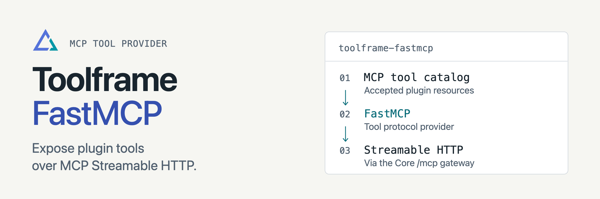

<p align="center">
<picture>
  <source media="(prefers-color-scheme: dark)" srcset="docs/assets/readme-banner-dark.png">
  <source media="(prefers-color-scheme: light)" srcset="docs/assets/readme-banner-light.png">
  
</picture>
</p>

# Toolframe FastMCP

[](https://github.com/toolframe/toolframe-fastmcp/actions/workflows/ci.yml?query=branch%3Amain)

Expose Toolframe business tools to MCP clients through FastMCP.
Core’s gateway serves the accepted tool catalog over stateful Streamable HTTP at `/mcp`.

## Quick start

In a running [Toolframe application](https://github.com/toolframe/toolframe-core#readme):

```sh
toolframe --home APP plugin add pypi:toolframe-fastmcp==0.3.1 --enable
```

Use Python 3.14+ and a compatible Core/SDK pair. Add a business plugin with MCP
tool declarations, then point your client at the application's `/mcp` URL.
The Entry Register recipe includes both this provider and a read-only list tool.

**Access:** MCP has its own public/protected policy. Configure
[MCP authentication](https://github.com/toolframe/toolframe-core/blob/main/docs/mcp-authentication.md) before sharing
private tools. The provider publishes tools; MCP resources and prompts are outside
its current contract. Catalog changes replace the worker, so clients must reconnect.

**macOS Intel:** PyPI-only installation may require native build dependencies.
The matching Core launcher supplies a verified companion wheel; see
[Intel installation details](docs/macos-intel.md).

## Guides

| I want to… | Start here |
| --- | --- |
| Understand sessions and publication | [Runtime behavior](docs/runtime.md) |
| Verify gateway and client behavior | [Acceptance checks](docs/verification.md) |
| Build the Intel companion | [macOS Intel](docs/macos-intel.md) |
| Contribute or run checks | [Contributing](CONTRIBUTING.md) · [Verification](docs/ci.md) |
| Publish a package | [Releasing](docs/releasing.md) |

[Releases](https://github.com/toolframe/toolframe-fastmcp/releases)

## License

[Apache 2.0](LICENSE), with [NOTICE](NOTICE).
